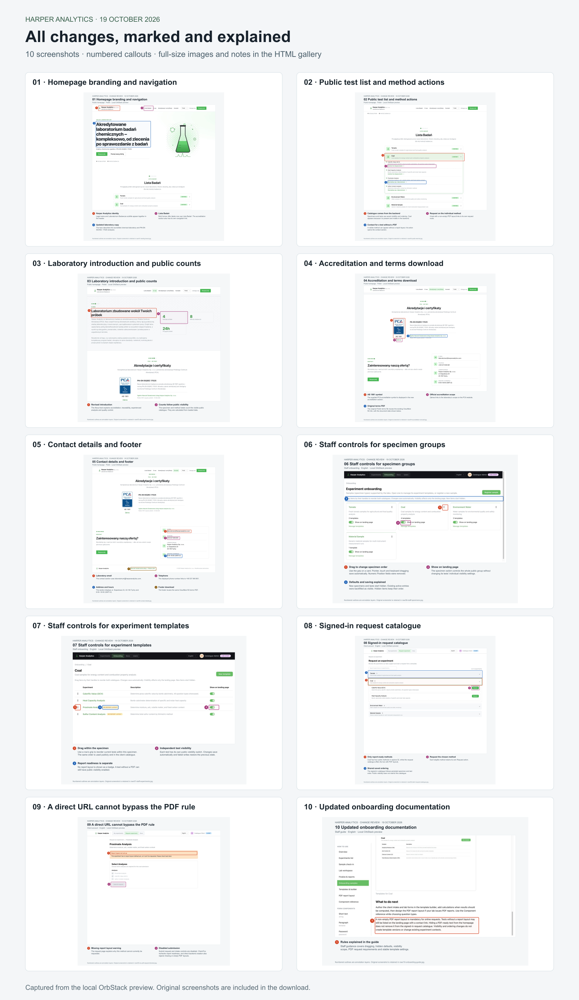

# Catalogue and homepage change review

Annotated screenshots captured from the local OrbStack testing environment on
19 October 2026. The numbered callouts explain the changes across ChemFox and
Experiment Manager. Catalogue contents and counts reflect the local test data.

| Screenshot | Changes shown |
| --- | --- |
| [Homepage](01-landing-brand.png) | Harper Analytics identity, laboratory subtitle and Lista Badań navigation |
| [Public test list](02-public-test-list.png) | Backend catalogue, saved visibility/order and per-test request/contact actions |
| [About and counts](03-about-and-counts.png) | Laboratory introduction and visible catalogue counts |
| [Accreditation](04-accreditation-and-pdf.png) | AB 1981 mark, PCA scope link and existing Cloudflare R2 terms PDF |
| [Contact](05-contact-details.png) | Updated contact information and footer |
| [Specimen onboarding](06-staff-specimens.png) | Drag handles, landing-page visibility and automatic saving |
| [Experiment onboarding](07-staff-experiments.png) | Drag-only ordering within a specimen and independent template visibility |
| [Client catalogue](08-client-request-catalogue.png) | Saved order and PDF-ready requestable experiments |
| [PDF requirement](09-no-pdf-request-blocked.png) | Missing PDF report layout blocks requests through a direct URL |
| [Onboarding guide](10-onboarding-guide.png) | Visibility defaults and ordering guidance |

The PNGs preserve the reviewed annotations. The full-resolution raw captures and
editable annotation layers remain in the separate local review bundle.
